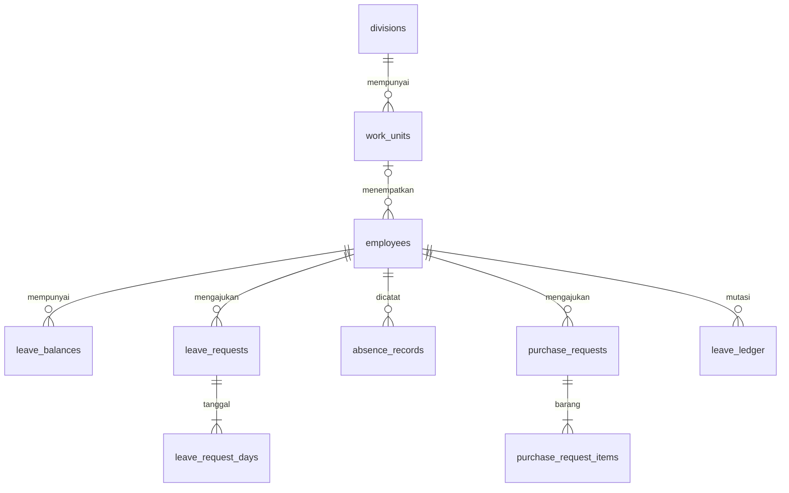

# Rancangan database Ruang Kerja 1.1.0

## 1. Database yang benar-benar digunakan

**Aplikasi hosted menggunakan Cloudflare D1 dengan model SQLite/Drizzle di [`db/schema.ts`](../db/schema.ts).** Data transaksi disimpan oleh API server; tampilan browser bukan sumber saldo atau keputusan approval.

Lampiran `gamstrlv2.sql` berasal dari **MySQL 5.7.24** dan hanya memuat struktur 28 tabel. Tidak ada `INSERT`, data karyawan aktual, saldo, akun, ataupun transaksi aktual dalam lampiran. Karena itu data contoh pada workspace demonstrasi adalah data fiktif, bukan hasil migrasi perusahaan.

Paket database memuat jalur berikut:

| Jalur | Sumber schema | Penggunaan |
|---|---|---|
| Aplikasi hosted yang disediakan | `db/schema.ts`, migration dalam `drizzle/` | D1/SQLite melalui binding server. |
| Rancangan target on-premise | [`database/mysql8-schema.sql`](../database/mysql8-schema.sql) | MySQL **8.0.16 atau lebih baru** agar `CHECK` benar-benar ditegakkan; InnoDB, utf8mb4. |
| Upgrade target MySQL 1.0.1 | [`database/mysql8-upgrade-1.1.0.sql`](../database/mysql8-upgrade-1.1.0.sql) | Menambah organisasi dan memperbarui level akun pada target yang sudah terisi. |
| Migrasi data legacy ke target MySQL | [`database/migrate-master-data.sql`](../database/migrate-master-data.sql) | Staging dan pemindahan master tervalidasi dari `gamstrlv2` ke `gamstrlv2_next`. |

**File MySQL adalah rancangan dan template migrasi, bukan driver MySQL yang otomatis dipakai aplikasi hosted.** Untuk menjalankan versi on-premise dengan MySQL, adapter database, autentikasi deployment, dan bootstrap operasional harus dipasang serta diuji. Mengganti connection string saja tidak cukup karena runtime saat ini menggunakan API D1 dan beberapa sintaks SQLite.

## 2. Perubahan terhadap database lama

Karyawan tetap mempunyai **NIP unik bertipe teks**, sehingga angka nol di depan tidak hilang. Aplikasi menggunakan ID internal untuk foreign key. Versi 1.1.0 mempunyai master `divisions` dan `work_units`; karyawan mereferensikan unit melalui `employees.work_unit_id`. Divisi diturunkan dari unit, sehingga tidak ada kolom divisi karyawan yang dapat berbeda dari master unit. `department` lama dipertahankan ketika upgrade untuk rekonsiliasi, sementara `position` tetap label jabatan. Pada penyimpanan karyawan melalui aplikasi, `department` mengikuti nama unit yang dipilih. Label unit sumber, telepon, status kerja lama, dan tanggal keluar tetap tersimpan dalam staging migrasi untuk peninjauan. Hierarki multi-perusahaan belum disediakan.

Struktur baru menambahkan hubungan atasan, identitas login yang terverifikasi, saldo per tahun, mutasi saldo, pengajuan dan rincian tanggal cuti, kalender terverifikasi, catatan sakit/alpa harian, permintaan pembelian beserta detailnya, histori approval, import, dan audit. Database lama tidak mempunyai tabel untuk saldo cuti, kalender, approval, maupun permintaan pembelian.

Seluruh 28 tabel sumber, nama kolom, dan perlakuan migrasinya dicatat dalam [`legacy-mapping.md`](../database/legacy-mapping.md). Tabel kontrak, keluarga, kontak darurat, training, klaim, dan modul lain tetap dipertahankan di sumber; migrasi inti ini tidak menghapus tabel tersebut.

## 3. Model data runtime: 17 tabel

| Tabel | Kolom / fungsi utama | Integritas |
|---|---|---|
| `organization` | Konfigurasi perusahaan, pemilik workspace, status bootstrap, kebijakan cuti bersama, hak tahunan default, jadwal kerja, penanda demo. | Satu row dengan `id = 'main'`; kebijakan `exclude`/`deduct`. Token bootstrap merupakan data internal server. |
| `divisions` | `id`, `code`, `name`, `sort_order`, `active`. | Kode/nama unik; status aktif 0/1; dua divisi awal. |
| `work_units` | `id`, `division_id`, `code`, `name`, `sort_order`, `active`. | FK divisi; kode unik; nama unik dalam divisi; status aktif 0/1; 15 unit awal. |
| `employees` | `id`, `nip`, `name`, `email`, `auth_subject`, `department`, `work_unit_id`, `position`, `manager_id`, `role`, `workdays`, `active`, `join_date`. | NIP/email/auth subject unik; FK unit dan atasan; tiga level akun; tidak boleh menjadi atasan diri sendiri; kelayakan/siklus atasan diperiksa service. |
| `calendar_years` | Tahun, status verifikasi, sumber, waktu/reviewer, revisi. | Tahun 2000–2200; kalender belum terverifikasi memblokir perhitungan/pengajuan tahun terkait. |
| `holidays` | Tanggal, nama, jenis nasional/cuti bersama, sumber, tahun. | Satu row per tanggal, FK tahun kalender, jenis dibatasi. |
| `leave_balances` | Karyawan/tahun, `entitlement`, `adjustment`, `used`, `reserved`. | Pasangan karyawan-tahun unik; saldo tersedia dan komponen penggunaan/penahanan tidak boleh negatif. |
| `leave_requests` | Nomor unik, pemohon, tipe annual/special, rentang, hari kerja, alasan, status, approver snapshot, catatan, policy snapshot. | Tanggal mulai ≤ akhir; hari > 0; status dibatasi; approver bukan pemohon. |
| `leave_request_days` | Setiap tanggal pada pengajuan, tahun, `chargeable`, alasan hitungan. | Pasangan request-tanggal unik; snapshot historis untuk penjelasan dan alokasi per tahun. |
| `leave_ledger` | Event unik, karyawan/tahun/request, empat delta saldo, actor, waktu. | `event_key` unik mencegah event keuangan cuti yang sama dicatat dua kali. |
| `absence_records` | Karyawan/tanggal, `sick` atau `unexcused`, alasan, pencatat, timestamps. | Karyawan-tanggal unik; service menolak tabrakan dengan cuti aktif. |
| `purchase_requests` | Nomor, pemohon, judul, departemen snapshot, prioritas, tanggal kebutuhan, alasan, total, status, approver. | Nomor unik; total ≥ 0; status/tahap dibatasi; approver bukan pemohon. |
| `purchase_request_items` | Request, nama barang, jumlah, satuan, harga rupiah, urutan. | Jumlah > 0; harga ≥ 0; FK request. |
| `approval_events` | Jenis entity, ID entity, tahap, keputusan, actor, catatan, waktu. | FK actor; referensi entity bersifat polymorphic dan diperiksa service. |
| `import_batches` | Checksum payload, jenis, jumlah baris, actor, waktu. | Checksum unik menjaga idempotensi batch saldo. |
| `audit_logs` | Action, actor, subject, detail perubahan terpilih, waktu. | FK actor; isi log tidak boleh memuat token/password/hash. |
| `mutation_guards` | Guard transaksi sementara: ID, valid. | `CHECK(valid = 1)` membatalkan seluruh batch jika kondisi berubah; row guard dihapus sebelum commit sukses. |

Hubungan data utama:



Kolom lengkap, default, index, foreign key, dan `CHECK` dapat ditinjau langsung di schema native dan file SQL MySQL. Diagram menampilkan hubungan utama; hubungan actor, approver, kalender, audit, dan optional request-ledger dijelaskan pada tabel di atas.

### Master divisi dan unit

| Divisi | Unit kerja |
|---|---|
| Divisi Produksi | Surfacing; Warehouse LAB; Coating; Quality Control; Delivery |
| Divisi Back Office | Admin Sales; Marketing; Sales; Customer Service; Accounting dan Tax; HR & General Affair; IT; Account Receiveable & Finance; Purchasing; Warehouse Goods |

Nama tersebut mengikuti daftar organisasi yang ditetapkan. ID dan kode stabil tersedia pada [`organization-units.json`](../lib/data/organization-units.json); kode `PURCHASING` dipakai untuk izin tahap Unit Purchasing. Semua penyimpanan karyawan melalui aplikasi mensyaratkan unit dan divisinya aktif. Kolom unit tetap nullable di database agar departemen legacy yang belum dikenali dapat dipertahankan; Administrator meninjau status **Belum dipetakan** pada form karyawan.

### Upgrade D1 1.0.1 → 1.1.0

Migration **[`0001_account_levels_organization.sql`](../drizzle/0001_account_levels_organization.sql)** menambah dua tabel, foreign key/index unit karyawan, master 2 divisi/15 unit, pemetaan lama, dan aturan tiga level akun. Migration awal `0000_productive_shatterstar.sql` tetap utuh. Database baru menjalankan `0000` lalu `0001`; database 1.0.1 hanya menjalankan `0001` yang belum diterapkan. Upgrade 1.0.0 → 1.0.1 sebelumnya tidak menambah migration.

Role `hr` dan `purchasing` yang sudah ada menjadi `manager` pada unit HR & General Affair dan Purchasing. Akun `employee` yang telah ditunjuk sebagai atasan karyawan aktif atau approver pengajuan cuti `pending`/pembelian `pending_manager` atau `pending_purchasing` juga menjadi `manager`, agar kemampuan approval penugasan lama tetap tersedia. Status aktif akun tidak diubah; referensi yang hanya ada dalam keputusan historis tidak menaikkan level akun.

Nama departemen yang cocok dengan master serta alias terbatas dipetakan ke unit. Nama nyata yang ambigu seperti `Manajemen`, `Operasional`, `Gudang`, dan `Finance` tetap belum dipetakan. Padanan khusus delapan identitas contoh hanya berlaku jika ID demo yang dikenal juga memakai email `@example.invalid`. Daftar alias dan padanan tercatat pada [panduan migration](../database/README.md).

Migration mempertahankan ID, NIP/email, `auth_subject`, label departemen lama, relasi atasan/approver, tanggal, saldo, ledger, status pengajuan, keputusan, import, dan audit. Tidak ada reset atau pengisian ulang transaksi. `CHECK employees_role` historis sengaja dipertahankan untuk menghindari pembangunan ulang tabel yang banyak direferensikan; trigger `employees_role_insert` dan `employees_role_update` menolak INSERT/UPDATE role selain `admin`, `manager`, dan `employee`. Snapshot Drizzle mengikuti pendekatan ini agar pembuatan migration berikutnya tidak mengusulkan rekonstruksi tabel yang tidak diperlukan.

## 4. Saldo, kalender, dan approval

### Saldo per karyawan dan tahun

Rumus yang digunakan:

```text
tersedia = entitlement + adjustment - used - reserved
```

`entitlement` adalah hak tahunan yang ditetapkan Administrator berdasarkan kebijakan HR. `adjustment` adalah koreksi bertanda positif/negatif. `used` adalah cuti tahunan yang sudah disetujui, sedangkan `reserved` adalah cuti tahunan yang masih menunggu keputusan.

| Peristiwa | Perubahan saldo untuk cuti tahunan |
|---|---|
| Pengajuan baru | `reserved` bertambah sesuai hari yang dihitung. |
| Atasan menyetujui | `reserved` berkurang dan `used` bertambah dengan jumlah sama. |
| Ditolak / pengajuan pending dibatalkan | `reserved` dikembalikan. |
| Administrator membatalkan pengajuan approved | `used` dikembalikan; alasan wajib dicatat. |
| Import hak/koreksi | Menetapkan `entitlement` dan `adjustment`; penggunaan/penahanan yang sudah ada dipertahankan. Delta dan batch dicatat. |

Cuti `special` memiliki alur approval tetapi tidak memotong saldo tahunan. `leave_request_days.chargeable` menjelaskan tanggal kerja yang dihitung dalam pengajuan; debit saldo tetap bergantung pada tipe `annual`, sehingga nilai ini tidak boleh dijumlahkan tanpa memeriksa tipe request.

Hari diproses sebagai tanggal bisnis **Asia/Jakarta**, bukan selisih jam pada browser. Kalender dicek untuk semua tahun dalam rentang. Jadwal per karyawan mendukung Senin–Jumat atau Senin–Sabtu. Hari libur nasional selalu dikecualikan. Cuti bersama mengikuti pilihan `exclude`/`deduct` perusahaan; default aplikasi `exclude`. Pilihan itu merupakan aturan aplikasi yang perlu dicocokkan HR dengan kebijakan perusahaan.

Jika cuti melintasi pergantian tahun, alokasi saldo dipecah menurut `leave_request_days.year`. Rincian tanggal, alasan tidak dihitung, jadwal kerja, kebijakan cuti bersama, dan revisi kalender disimpan sebagai snapshot. Approval/refund menggunakan snapshot permintaan tersebut, sehingga perubahan kalender sesudah pengajuan tidak otomatis mengubah potongan lama.

**Kalender yang belum diverifikasi tidak dianggap sebagai tahun tanpa libur.** Administrator yang menangani kalender harus memuat/melengkapi tanggal resmi, meninjau sumber bersama HR, dan memverifikasi tahunnya. Perubahan manual pada kalender menghapus status verifikasi hingga ditinjau ulang.

### Approval dan otorisasi

| Nilai database/API | Label akun | Cakupan utama |
|---|---|---|
| `admin` | Administrator | Semua fitur, administrasi karyawan/saldo/kalender/sakit-alpa/pengaturan, serta approval delegasi sesuai aturan transaksi. |
| `manager` | Manager | Pengajuan sendiri, data tim yang diizinkan, dan approval permintaan yang menunjuknya sebagai atasan. |
| `employee` | Staff | Pengajuan dan data pribadi; tidak mempunyai izin approval atau administrasi. |

Pemohon harus memiliki atasan **aktif dengan level Manager atau Administrator** untuk mengirim pengajuan. Pilihan atasan dan rantai atasannya diperiksa agar tetap aktif, berlevel yang memenuhi syarat, dan tidak membentuk siklus. Penempatan di divisi/unit yang sama tidak otomatis memberikan hak approval. ID atasan disalin ke `approver_id` pada saat pengajuan, sehingga pergantian atasan pada master tidak diam-diam memindahkan pengajuan lama. Manager aktif yang ditunjuk dapat memutuskan pengajuan; Administrator dapat bertindak sebagai delegasi. Pemohon selalu dilarang menyetujui permintaannya sendiri.

Pembelian memiliki tahap `pending_manager` → `pending_purchasing` → `approved` → `ordered` → `received`, serta cabang `rejected`/`cancelled`. Setelah persetujuan atasan, tahap Unit Purchasing hanya dapat ditangani **Administrator atau Manager dengan kode unit `PURCHASING`**, yang bukan pemohon. Unit dan divisi Manager Purchasing harus aktif. Staff di unit Purchasing tetap tidak dapat menyetujui, memesan, atau menandai penerimaan. Histori setiap tindakan disimpan pada `approval_events`.

Karyawan yang sudah direferensikan transaksi dinonaktifkan melalui `active = 0`, sehingga identitas histori tidak hilang. Penonaktifan atau penurunan level menjadi Staff ditolak selama akun masih memiliki bawahan aktif, menjadi approver cuti `pending`, atau menjadi approver pembelian `pending_manager`. Alihkan bawahan dan selesaikan persetujuan yang masih ditugaskan sebelum mengubah level/status; Administrator dapat menangani keputusan sebagai delegasi. Penggantian atasan karyawan tidak mengubah snapshot approver pada permintaan yang sudah ada. Antrean `pending_purchasing` ditangani berdasarkan hak unit saat ini setelah tahap atasan selesai.

Administrator tidak dapat menonaktifkan atau mengganti level akun sendiri dari sesi yang sama, dan sistem mempertahankan minimal satu Administrator aktif. Pemeriksaan tanggung jawab, status, level, dan unit diperiksa ulang di dalam batch transaksi agar perubahan bersamaan tidak melewati aturan.

### Hal yang ditegakkan oleh service

Foreign key, `CHECK`, dan trigger role menguatkan integritas dasar. Service tetap memeriksa role/scope, unit/divisi aktif, pemohon dan actor, kelayakan/siklus atasan, tanggung jawab yang belum selesai, konflik rentang cuti, tabrakan sakit/alpa, batas angka, sumber kalender, dan transisi status. Total pembelian dihitung ulang dari detail oleh server. Referensi polymorphic `approval_events.entity_id` tidak mempunyai FK langsung ke dua tabel request, sehingga penulisan langsung di luar service dapat menghindari pemeriksaan tersebut.

D1 mengeksekusi guard, mutasi, ledger, approval, dan audit dalam satu batch atomik. Kegagalan guard membatalkan batch, termasuk penahanan saldo. Untuk adapter MySQL, jalur ini harus diterjemahkan ke transaksi InnoDB dengan pemeriksaan ulang dan kunci yang sesuai. Mengganti sintaks query tanpa melindungi transaksi dari konkurensi belum cukup.

## 5. Perbedaan native D1 dan target MySQL

| Aspek | Native D1 | Target MySQL / pekerjaan adapter |
|---|---|---|
| Driver | Binding D1 dan prepared statements. | Gunakan driver MySQL server-side dan repository/adapter baru. |
| Tanggal bisnis | Teks `YYYY-MM-DD`. | `DATE`; driver harus mengembalikan string tanggal tanpa pergeseran zona waktu. |
| Timestamp | Teks ISO UTC, misalnya format hasil `toISOString()`. | `DATETIME(3)` disimpan UTC; format ulang secara eksplisit ke ISO UTC pada API. |
| Snapshot/detail | JSON diserialisasi di kolom teks. | Kolom `JSON`; jaga apakah adapter mengembalikan object atau string agar kontrak API tetap sama. |
| Boolean | Integer 0/1. | `TINYINT`; normalisasi ke boolean pada API. |
| Rupiah | Integer dengan validasi safe integer JavaScript. | `BIGINT`; driver dapat mengembalikan string. Konversi hanya sesudah memeriksa batas aman. |
| Kuantitas/hari | Bilangan bulat. | `INT`; versi ini belum mendukung jumlah pecahan atau cuti setengah hari. |
| Unique/collation | Perbandingan teks SQLite. | ID/NIP/email menggunakan `utf8mb4_bin`; tetap normalisasikan email/spasi di server. Aturan padding/Unicode MySQL dapat berbeda, sehingga uji benturan sebelum migrasi. |
| Upsert | `ON CONFLICT ... DO UPDATE`. | Terjemahkan ke `ON DUPLICATE KEY UPDATE` atau transaksi setara. |
| Transaksi | Batch D1 + guard `CHECK`. | Transaksi InnoDB, kunci row/predicate yang benar, rollback, penanganan konflik dan retry. |
| Tiga role | CHECK historis dipertahankan; trigger INSERT/UPDATE menegakkan tiga nilai sekarang. | Schema baru memakai CHECK tiga role; upgrade mengganti CHECK setelah memetakan role lama. |
| Identitas | Stable `auth_subject` dari autentikasi workspace. | Siapkan identity provider yang diverifikasi; jangan memakai email sebagai pengganti subject tanpa proses verifikasi. |
| Bootstrap | Bootstrap demo aplikasi hosted. | Siapkan bootstrap produksi sendiri; jangan menjalankan seed demo ke database perusahaan. |

Schema MySQL mencerminkan **17 tabel runtime**, termasuk master divisi dan unit yang dipakai aplikasi. Empat tabel tambahan dalam script migrasi memakai awalan `legacy_` dan merupakan area staging/rekonsiliasi, bukan tabel yang otomatis dibaca UI.

`CREATE TABLE IF NOT EXISTS` membuat file schema dapat diulang pada target dengan struktur yang sama. Pernyataan tersebut **tidak** memperbarui struktur lama yang berbeda. Untuk target 1.0.1 yang sudah terisi, gunakan [`mysql8-upgrade-1.1.0.sql`](../database/mysql8-upgrade-1.1.0.sql) satu kali; script menambah master/unit karyawan, memetakan role/unit lama, mengganti CHECK role, dan menambah `target_work_unit_id` pada staging impor bila sudah ada. DDL MySQL melakukan implicit commit, sehingga backup, penghentian penulisan, dan uji pada salinan target diperlukan sebelum menjalankannya.

## 6. Prosedur migrasi master

### Persiapan dan peninjauan

1. Buat salinan database sumber untuk uji. Pastikan export data aktual tersedia; lampiran saat ini baru struktur.
2. Jalankan [`legacy-preflight.sql`](../database/legacy-preflight.sql) dengan akun hanya-baca. Periksa NIP/email kosong atau bentrok setelah normalisasi, master organisasi, tanggal nol, orphan, rekap negatif, dan definisi encoding.
3. Buat target `gamstrlv2_next` dengan `mysql8-schema.sql` versi 1.1.0. Jika target aplikasi 1.0.1 sudah ada, gunakan `mysql8-upgrade-1.1.0.sql` terlebih dahulu. Jangan mengganti nama database sumber menjadi target.
4. Jalankan `migrate-master-data.sql` pada MySQL 8 dengan `@migration_apply = 0`. Script hanya memuat staging, membuat routine target, dan menampilkan ringkasan validasi; master aplikasi belum diisi.
5. HR meninjau kolom target pada `legacy_employee_stage`, sementara `source_payload` mempertahankan nilai sumber. Lengkapi email nyata, nama, jabatan, tanggal masuk, status aktif, jadwal, dan NIP atasan. Pilih `target_work_unit_id` dari unit/divisi aktif; label asli `department` dan `unit_source` tetap tersimpan di staging. Tidak ada data yang dikarang untuk mengisi kolom wajib.
6. Role default staging `employee` (Staff). Hanya `admin`, `manager`, dan `employee` yang diterima; penetapan role lain di antara tiga pilihan tersebut harus melalui peninjauan yang sah. Role tidak langsung menautkan identitas login karena `auth_subject` tetap NULL.
7. Atasan harus ada di target atau menjadi calon migrasi yang sudah ditinjau, aktif, dan berlevel Administrator atau Manager. Puncak organisasi yang benar-benar tidak mempunyai atasan dapat diberi waiver beralasan; waiver tidak membuat pengajuan otomatis approved dan tidak melewati aturan pengajuan aplikasi.
8. Isi `reviewed = 1`, `reviewed_by`, dan `reviewed_at` untuk row yang sudah disetujui HR. Jangan menandai semua row tanpa pemeriksaan.

### Preview dan commit

```sql
-- Masih hanya preview; nama batch harus sesuai staging yang ditinjau.
CALL gamstrlv2_next.migrate_legacy_master_v1('gamstrlv2-master-v1', 0);

-- Jalankan sesudah hasil preview dan rekonsiliasi disetujui.
CALL gamstrlv2_next.migrate_legacy_master_v1('gamstrlv2-master-v1', 1);
```

Commit hanya memasukkan calon karyawan yang lolos validasi unit/divisi, role, dan data wajib serta belum dipetakan. Row bermasalah tetap di staging. Jika atasan calon tersebut hilang/tidak aktif/belum ditinjau/berlevel Staff atau jalurnya bersiklus, seluruh commit master dibatalkan. Pemeriksaan rekursif membatasi jalur pada 200 tingkat untuk menghindari struktur tidak wajar.

ID target dibuat deterministik dari NIP teks; `legacy_employee_map` mencatat NIP sumber → ID target. Pengulangan batch tidak membuat duplikasi dan tidak menimpa karyawan target yang sudah dipetakan. Benturan dengan record target yang belum mempunyai pemetaan ditandai untuk rekonsiliasi, bukan ditimpa.

Jika fingerprint sumber berubah setelah snapshot staging, row ditandai `SOURCE_CHANGED`. Buat batch snapshot baru setelah HR meninjau perubahannya. Saldo, approval historis, dan akun tidak diciptakan oleh script master. Jalankan commit saat penulisan sumber/target dihentikan untuk cut-over dan jangan memakai opsi client yang mengabaikan error.

### Histori dan saldo awal

`legacy_leave_history_stage` mempertahankan proyeksi sumber `tcuti` dengan status `pending_hr_review`. Status approved/rejected dan saldo yang sudah dipakai tidak tersedia pada tabel lama, sehingga tidak dimasukkan ke ledger otomatis.

`legacy_absence_summary_stage` menyimpan proyeksi rekap NIP/periode/empat bilangan absensi. Fingerprint dan `source_occurrences` mempertahankan banyaknya row identik dalam proyeksi tersebut; `source_seen_occurrences` menandai hitungan terbaru pada replay. Kolom SP dan atribut lainnya tetap berada pada database lama. Ringkasan tidak diubah menjadi kejadian harian fiktif. Setelah source berubah atau berkurang, lakukan rekonsiliasi dan gunakan batch snapshot baru.

HR menyiapkan hak/koreksi saldo tahun yang akan digunakan melalui import terpisah. File saldo aplikasi menetapkan hak dan penyesuaian; `used` dan `reserved` aktif dipertahankan. Untuk saldo awal sistem yang berasal dari posisi legacy, tentukan tanggal cutoff dan koreksi yang disepakati HR, serta pisahkan histori referensi dari transaksi operasional baru agar tidak terjadi debit ganda.

## 7. Rekonsiliasi integritas

Contoh berikut ditujukan ke target MySQL dan hanya membaca data. Jangan menambahkan transaksi langsung ke `leave_balances` tanpa event ledger yang sesuai.

### Saldo harus sama dengan akumulasi ledger

```sql
SELECT b.employee_id, b.year,
       b.entitlement, COALESCE(l.entitlement, 0) AS ledger_entitlement,
       b.adjustment, COALESCE(l.adjustment, 0) AS ledger_adjustment,
       b.used, COALESCE(l.used, 0) AS ledger_used,
       b.reserved, COALESCE(l.reserved, 0) AS ledger_reserved
FROM leave_balances b
LEFT JOIN (
  SELECT employee_id, year,
         SUM(entitlement_delta) AS entitlement,
         SUM(adjustment_delta) AS adjustment,
         SUM(used_delta) AS used,
         SUM(reserved_delta) AS reserved
  FROM leave_ledger
  GROUP BY employee_id, year
) l ON l.employee_id = b.employee_id AND l.year = b.year
WHERE b.entitlement <> COALESCE(l.entitlement, 0)
   OR b.adjustment <> COALESCE(l.adjustment, 0)
   OR b.used <> COALESCE(l.used, 0)
   OR b.reserved <> COALESCE(l.reserved, 0);
```

Hasil yang diharapkan kosong. Perbedaan harus ditelusuri pada batch/event sumber; jangan menutup selisih dengan menulis angka acak ke saldo.

### Penahanan saldo harus sesuai request pending tahunan

```sql
SELECT b.employee_id, b.year, b.reserved,
       COALESCE(p.pending_days, 0) AS expected_reserved
FROM leave_balances b
LEFT JOIN (
  SELECT r.employee_id, d.year, SUM(d.chargeable) AS pending_days
  FROM leave_requests r
  JOIN leave_request_days d ON d.request_id = r.id
  WHERE r.type = 'annual' AND r.status = 'pending'
  GROUP BY r.employee_id, d.year
) p ON p.employee_id = b.employee_id AND p.year = b.year
WHERE b.reserved <> COALESCE(p.pending_days, 0);
```

Uji penerimaan mencakup cuti melintasi akhir pekan/libur nasional/tahun, dua pengajuan bersamaan yang melebihi saldo, approval berulang, penolakan, pembatalan, import saldo yang sama, konflik sakit/alpa, dan larangan approval sendiri. Untuk 1.1.0, periksa pula batas Administrator/Manager/Staff, Staff Purchasing yang tetap tidak berhak memproses, unit/divisi tidak aktif, kelayakan atasan, perlindungan penurunan level, dan preservasi data saat upgrade. Periksa hasil pada database serta API, bukan hanya angka yang ditampilkan di layar.

## 8. Rollback dan batas verifikasi

Sebelum migrasi, simpan backup sumber dan target dengan kontrol akses internal. Target baru dibuat berdampingan; source tetap utuh. DDL MySQL dapat melakukan implicit commit, sehingga pembuatan schema/staging tidak diklaim dapat dibatalkan oleh transaksi master. Procedure migrasi mempunyai handler yang menjalankan `ROLLBACK` dan `RESIGNAL` jika ada kesalahan saat commit master.

Jika uji migrasi belum menerima transaksi operasional, kembalikan snapshot target sebelum migrasi atau gunakan target uji baru. Jangan menghapus transaksi lama pada source. Setelah aplikasi target sudah menerima transaksi baru, hentikan input, rekonsiliasi delta sejak cut-over, dan tentukan pengembalian yang mempertahankan transaksi tersebut; jangan menimpa target aktif dengan backup lama tanpa memeriksa delta.

DDL dan template MySQL disusun sesuai schema native serta ditinjau secara statis. Lingkungan pengerjaan ini tidak menyediakan server MySQL, sehingga file tersebut **belum diuji eksekusi pada instance MySQL perusahaan**. Uji D1 aplikasi dan uji migrasi MySQL adalah dua jenis verifikasi yang berbeda; kelulusan salah satunya tidak membuktikan adapter atau migration lainnya sudah teruji.

Migration D1 1.1.0 diuji melalui [`organization-migration.test.mjs`](../tests/organization-migration.test.mjs) pada SQLite Node dan D1/workerd. Tiga skenario memeriksa database baru, upgrade database 1.0.1 berisi fixture beserta seluruh tabel historinya, dan akun nyata dengan ID yang menyerupai demo. Semua skenario lulus; data perusahaan tidak dipakai dalam fixture tersebut.
